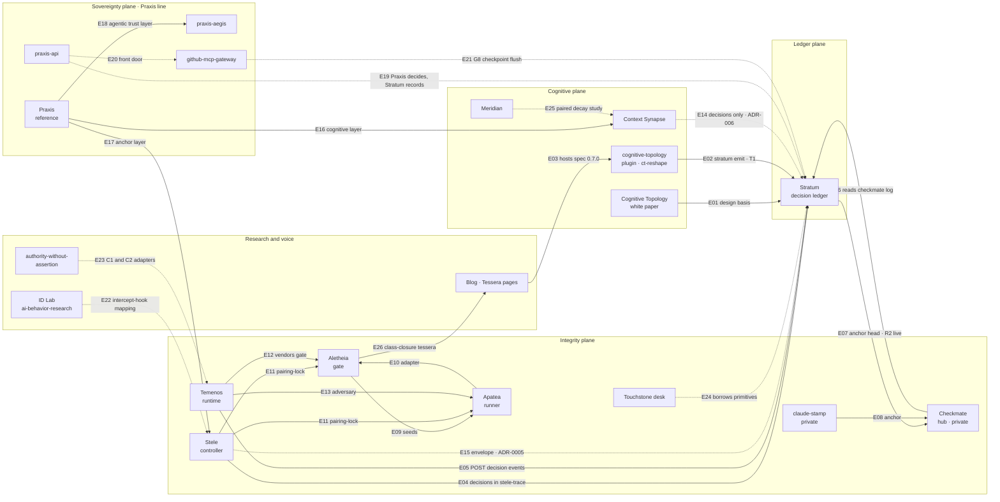

# Tracks map — the wider architecture

> Parallel tracks that build into a wider architecture beyond Stratum: the successor to the Praxis architecture, a cognitive architecture for AI-augmented engineering, local-first and vendor-agnostic, built by and for neurodivergent intelligences, human and non-human. Mazze calls the whole *the egregore*; the reshape analysis calls the finished building *the cathedral*.

This page maps what each track is, where it actually stands on `main`, what it produces and consumes, and how the tracks connect. It is a map, not a plan: it records edges, it does not build them.

## How to read this map

**State** of a track:

- **shipped**: on `main`, running or released, with evidence cited.
- **in progress**: code exists, the named next phase is open.
- **seed**: a scaffold or a single commit.
- **cathedral target**: designed in a spec or paper, deliberately deferred, not deleted.

**Edges** carry one of two marks:

- **[D]** documented: a file in a repo says so. The citation is `repo:path §section`.
- **[I]** inferred: my reading of two documents side by side. No file states it. Treat as a hypothesis.

A documented edge can still be *proposed* (written down, not built). The edge register says which.

"Waits on Mazze" notes are context on an edge, not asks.

## The shape in one picture

Solid arrows are documented and built. Dashed arrows are documented but proposed or deferred, or inferred (the register below says which).

## Tracks

### Ledger plane

#### Stratum — the nexus
- **Purpose:** an epistemic decision ledger. Status is a fold over append-only events; evidence and claim never merge (`stratum:docs/SPEC.md`).
- **State: shipped.** v0.5.0 GitHub bundle released 2026-11-13; npm publishing failed and Homebrew is not a verified install path. Worker plus Durable Object single writer; Python oracle and TypeScript core byte-identical on the golden set; CLI `@stratum-ledger/cli`. Trust primitives (`stratum:docs/ADR-003-trust-primitives.md`, `docs/journal/2026-10-06-trust-primitives/CHECKPOINT.md`): R1, R2 and R3 done, R4 authority registry, R5 first external writer and R6 memory model open.
- **Produces:** decision, evidence and foreclosure events; derived status; `DECISIONS.md`; a verification re-checker.
- **Consumes:** events over `/api/logs/{log}/events`, `stratum emit` (ingress, `cli/lib/ingress.mjs`), repo traces in `data/*-trace.jsonl`.
- **Cathedral target:** the white paper's macOS workbench with twelve roles and six memory tiers (`stratum:docs/stratum-reshape-analysis-v0.4.0.md.md`: "Stratum v0.4.0 is the first brick. The cathedral is still the cognitive workbench").
- **R2 operation:** live. PR 108 merged the anchor cron and full-truncation detection; the first production tick, 2026-11-15 21:00Z, anchored `stratum:demo` to the Checkmate hub, and sampled ticks since log `extends / unchanged` (`stratum:docs/ADR-004-off-system-anchor.md`, Accepted in #120; trust-primitives CHECKPOINT R2). R2b, Rekor over the hub head, is not started. PR 109 and blog PR 225 are merged.

### Integrity plane

#### Aletheia — the gate
- **Purpose:** prompt-injection detection that tracks provenance and flags when an untrusted source supplies a parameter that will govern an action (`aletheia:README.md`).
- **State: shipped, shadow mode by default.** v0.2.0; enforce mode is opt-in. Latest work 2026-11-14 (#32, #33).
- **Produces:** score and band (proceed / verify / stop, exit 0/1/2), a hash-only audit log, the `evals/malicious` corpus, a parity golden.
- **Consumes:** WebSearch and WebFetch PostToolUse payloads plus a declared source.

#### Apatea — the runner
- **Purpose:** adversarial invariant search, `atoms × transformations × invariants → findings + perimeter`; "a runner: asynchronous, unbounded, and fails loud" (`apatea:README.md`).
- **State: shipped as a CLI**, not a scheduled service. v0.1.0. Seed contract gated in CI 2026-11-14 (#3, #4).
- **Produces:** findings, a perimeter report of what held, a hashed JSONL log. Output is labelled untrusted input.
- **Consumes:** target adapters and Aletheia seeds via `ALETHEIA_HOME`.

#### Temenos — the runtime
- **Purpose:** an evidence-gated runtime for agents: `signal → Aletheia gate → deterministic policy → Stratum ledger → human review`; "It must not manufacture permission" (`temenos:README.md`).
- **State: in progress.** v0.1.0 implemented and tested (`decide / audit / serve`); `docs/journal/PLAN.md` still shows phases unchecked, which reads stale against the code.
- **Produces:** verdicts and Stratum `decision` events with `birth_status: asserted`; never a stored status ("status is stratum's fold", `temenos:temenos/ledger.py`).
- **Consumes:** signals, Aletheia (vendored), a human-authored `policy/policy.yaml`, Apatea out of band.

#### Stele — the controller
- **Purpose:** a harness-level integrity controller for high-risk Claude sessions: compiles config into egregores, runs 13 deterministic tripwires, escalates one way only (ZANSHIN → UNHEIMLICH → WABI → EPOCHÉ), keeps a hash-chained audit trail (`stele:README.md`).
- **State: shipped.** v1.2.0, live page. ADR-0005 places Stele in the ecosystem as "direction, not a build order".
- **Produces:** an offline bundle, compiled instructions, an audit chain, recorded demos.
- **Consumes:** pasted config, model responses, the project registry.
- **Gate–runner pairing:** PR 119 (approved objective for the pairing) merged 2026-11-17.
- **Waits on Mazze:** the landing-page deploy waits on two repo secrets they add (not rechecked 2026-11-18).

#### Checkmate — the claim hub (private repo)
- **Purpose:** a security-claim control plane: an append-only ledger written by the human and by agents.
- **State: shipped**, in production. Details stay in the private appendix of this map's working copy.
- **Edges that are public here:** Stratum owns status and Checkmate never turns a claim into an approval (`stratum:docs/ADR-003-trust-primitives.md` §R2 and the Checkmate × Stratum joint spec v1, private). Stratum anchors its head to Checkmate's hub (R2).

#### claude-stamp (private repo)
- **Purpose:** a root-owned hook that appends a hash-chained row for every Claude Code event, anchored to the Checkmate hub.
- **State: shipped (stamp); anchor path partly unexercised.**

#### Touchstone — the desk
- **Purpose:** a defensive operations desk for biosecurity safeguard engagement (`touchstone:README.md`). Not the same thing as the `rigor:touchstone` verification skill.
- **State: seed to early.** Next.js desk with local state, Rust workspace, no CI.
- **Edges:** reimplements Stratum's evidence-gated ledger and authority basis, Stele's escalate-only machine and the Checkmate anchor contract (`touchstone:vendor/SOURCES.md`). Borrowed primitives, not runtime calls.

### Cognitive plane

#### Cognitive Topology — the white paper
- **Purpose:** the argument: cognition divisible, memory plural, handoffs need protocol (Tessera), specs precede agency. Ten principles, twelve roles, six layers, six memory tiers (`stratum:docs/cognitive-architecture-paper.md` §1–§6).
- **State: published as design basis.** The PDF edition's appendix names Stratum "a macOS workbench and CLI currently in development against it" and lists what is permanently out of scope, operational context inference first.
- **Load-bearing rules for every other track:** §3.8 "Humans are not the orchestration layer. They are the *appellate* layer." §5.6 notification / confirmation / arbitration tiers. §6.9 "the user pins by explicit gesture; agents may *request* a pin."

#### cognitive-topology plugin and ct-reshape (Tessera)
- **Purpose:** the paper's plugin, reshaped into gated tranches T1–T5 (council report, 2026-10-21: "A modified, T1 only, gated").
- **State: T1 shipped; spec 0.7.0 accepted.** T1 ingress lives upstream in Stratum (ig-000, PR #101, verified ig-005). Blog PR 225 and Stratum PR 109 are merged; ig-006 pins the spec hash. T2 and T4 are held until the plugin source has a repo home; T3 is split out as Context Synapse work (spec 0.7.0 §13).
- **Produces:** events through `stratum emit`; the Tessera pages on the blog (`mazze-leczzare-blog:src/content/tesserae/`).
- **Remaining:** plugin source home and the narrower token remain undecided; merging the spec did not adopt either.

#### Context Synapse
- **Purpose:** "a local-first macOS system for modeling, retrieving, and inspecting contextual weight across AI-assisted work"; "the bridge" between AI and neurodivergent intelligence (`context-synapse:README.md`).
- **State: shipped, research-grade.** v0.3.0 tagged, v0.4 partly shipped; instrument collection paused for attribution and sampling validity (`docs/INSTRUMENT.md`).
- **Produces:** assembled prompts, Beta priors, decay and rot weights, a local observation ledger, referee interventions.
- **Consumes:** queries, feedback, app, focus and time triggers, hashed commit events.
- **Boundary it already states:** "Operational context inference is permanently out of scope… an ethical and privacy boundary, not a technical one" (`context-synapse:CLAUDE.md` Scope Constraint). The referee "models distraction, not cognitive collapse" (README, Design invariants, citing ethics ADR-002, which is recorded inline and has no file). Referee hiding is visible only, by Mazze's decision of 2026-11-15 (wt-025); see tension 1.

#### Meridian
- **Purpose:** a privacy-first, local-first calendar that treats the schedule as something you experience, "without ever naming, scoring, or judging an emotion" (`meridian:README.md`).
- **State: in progress.** Layer 1 steps 1–3 done (Automerge docs, encrypted store, 20/20 tests); compaction next; UI and affect engine not started.
- **Produces:** encrypted event and affect CRDTs; one bit (show a schedule-review prompt or not).
- **Rules:** emotion words banned in all system copy (D1-09); no causal claims; no imperatives such as "you should" (`meridian:CLAUDE.md`, Closed Decisions and prohibited constructions).

### Sovereignty plane — the Praxis line

#### Praxis — the predecessor
- **Purpose:** "a personal operating system built around one premise: identity, memory, and trust should be owned locally" (`praxis:README.md`).
- **State: reference.** Docs only. Nothing in the repo calls it superseded; the egregore is its successor by Mazze's word.
- **Its stack** (`praxis:ARCHITECTURE.md`, The Sovereignty Stack): Anchor (Stele), Identity (DAEDALUS), Cognitive (Context Synapse), Agentic Trust (praxis-aegis), Community (Secure Pride), Voice (the blog). Built: DAEDALUS ↔ Context Synapse and the aegis gateway. Not built: the rest of the wiring.

#### praxis-aegis
- **Purpose:** a hardware-key-gated policy gateway between AI runtimes and tools (`praxis-aegis:README.md`).
- **State: in progress.** Tiers T0–T2 enforce end to end; T3 is a stub.

#### praxis-api
- **Purpose:** policy enforcement at the agent–tool boundary as a small Worker; "Praxis decides, the service acts, Stratum records" (`praxis-api:README.md`, Where it fits).
- **State: in progress, not deployed** (`ai-behavior-research:docs/reviews/informed-consent-intercept-hook/`, praxis comparison §4.3, checked 2026-10-28). Its relation to praxis-aegis (same tiers, Workers rewrite) is [I].

#### github-mcp-gateway
- **Purpose:** a remote MCP server that gives MCP clients authenticated GitHub access over OAuth 2.1 on Workers.
- **State: shipped**, v1.1.0, deploy on merge. This map was checked partly through it.

### Research and voice

#### ID Lab (`ai-behavior-research`)
- **Purpose:** the research site and evidence registry for observable model behaviour; `apps/registry/public/method.html` is "Protocol and evidence standards / ID Lab"; "identity dissolution" is a historical title.
- **State: shipped site, research in progress.** v0.1.0-rc.2; smoke releases "do not establish scientific findings". Stratum integration: deferred (`studies/persona-integrity/docs/decisions.md`).

#### authority-without-assertion
- **Purpose:** measures whether generated information acquires operational authority by being generated, persisted or repeated.
- **State: seed (protocol stage).** No trials run; runs are blocked until the protocol freeze and tag exist.

#### Blog and the Tessera pages
- **Purpose:** the public voice; hosts the ct-reshape spec and the Tessera pages.
- **State: shipped.** Merge deploys the site.

### Seeds and names without repos

- **Seeds:** mindful-dev (a pre-action gate for Claude Code, small, shipped), delegation-harness (empty), matrioshka-brain-spec (fiction spec, stubs).
- **No repo:** **Kintsugi** exists as a module (`vaultrag/kintsugi.py` in a private predecessor repo) and as a palette name; **macprobe** is referenced across repos (`stratum:docs/DECISIONS.md`, `context-synapse:docs/DATA-CLASSIFICATION.md` D4) but has no repository under that name.
- **Name collisions to keep apart:** Touchstone repo vs Touchstone skill; Stele's PALIMPSEST detection module vs the Palimpsest project; Tessera (paper packet, Stele type, ct-reshape projection, blog page).

## Edge register

| ID | From → To | What flows | Mark | Built? | Source |
|---|---|---|---|---|---|
| E01 | White paper → Stratum | design basis | D | target | paper PDF, Appendix; `stratum:docs/stratum-reshape-analysis-v0.4.0.md.md` |
| E02 | ct plugin → Stratum | events via `stratum emit` | D | T1 built | `stratum:docs/DECISIONS.md` ig-000–ig-005; ig-006/007 via PR 109 (merged) |
| E03 | Blog → ct-reshape | hosts spec, changelog, trace | D | built | `mazze-leczzare-blog:public/cognitive-topology/reshape/`; PR 225 (merged) |
| E04 | Stele → Stratum | Stele decisions recorded in Stratum | D | built | `stratum:data/stele-trace.jsonl` st-000 |
| E05 | Temenos → Stratum | `decision` events, asserted, with evidence | D | built | `temenos:temenos/ledger.py` |
| E06 | Checkmate → Stratum | reads Checkmate's Stratum log; status stays Stratum's | D | built | joint spec v1 (private); `stratum:docs/ADR-003-trust-primitives.md` |
| E07 | Stratum → Checkmate | head anchored off-system (R2) | D | built | Stratum PR 108; live per #120, `stratum:docs/ADR-004-off-system-anchor.md` |
| E08 | claude-stamp → Checkmate | ledger anchors | D | partly | claude-stamp README (private) |
| E09 | Aletheia → Apatea | malicious corpus as seeds | D | built | `apatea:README.md` Seed fodder |
| E10 | Apatea → Aletheia | target adapter | D | built | `apatea:targets/aletheia_adapter.py` |
| E11 | Stele → Aletheia, Apatea | pinned pairing, CI eval | D | built | `stele:evals/pairing-lock.json`; Stele PR 119 (merged) |
| E12 | Temenos → Aletheia | gate (vendored) | D | built | `temenos:temenos/gate.py` |
| E13 | Temenos → Apatea | adversary pass | D | built | `temenos:temenos/adversary.py` |
| E14 | Context Synapse → Stratum | decisions only (sb-020–sb-024); telemetry never | D | proposed | `context-synapse:docs/adr/ADR-006-ledger-separation.md` (PROPOSED) |
| E15 | Stele → Stratum | session envelope; Tessera projection may live in Stratum | D | proposed | `stele:docs/adr/0005-ecosystem-position.md` |
| E16 | Praxis → Context Synapse | cognitive layer; DAEDALUS switch saves CS state | D | built | `praxis:ARCHITECTURE.md` |
| E17 | Praxis → Stele | anchor layer | D | named | `praxis:CLAUDE.md` |
| E18 | Praxis → praxis-aegis | agentic trust layer | D | partly | `praxis-aegis:README.md` |
| E19 | praxis-api → Stratum | "Praxis decides, the service acts, Stratum records" | D | proposed | `praxis-api:README.md` Where it fits |
| E20 | praxis-api → github-mcp-gateway | authorization front door | D | proposed | `praxis-api:README.md` |
| E21 | github-mcp-gateway → Stratum | checkpoint flush on reauthorization (G8) | D | proposed | `github-mcp-gateway:docs/incidents/2026-09-17-oauth-grant-reclamation.md` |
| E22 | ID Lab → Stele | intercept hook mapped onto Stele's state machine; Stele as the single decision point | D | proposed | `ai-behavior-research:docs/reviews/informed-consent-intercept-hook/` §3, §5 |
| E23 | authority-without-assertion → Temenos, Aletheia, Stratum, Stele | conditions C1, C2 need adapters | D | deferred | `authority-without-assertion:src/awa/runner/conditions.py` |
| E24 | Touchstone → Stratum, Stele, Checkmate | reimplemented primitives | D | borrowed | `touchstone:vendor/SOURCES.md` |
| E25 | Meridian ↔ Context Synapse | paired prediction-error and decay study | I | — | parallel ε models in both READMEs; the pairing note lives in a private registry |
| E26 | Aletheia → Blog | class-closure Tessera page | D | built | `mazze-leczzare-blog:src/content/tesserae/class-closure.mdx` |
| E27 | Context Synapse → Stratum | local-first Stratum as reopen condition | D | target | ADR-006 reopen condition 1 |
| E28 | Stele → Temenos | **not** a runtime dependency | D | ruled out | `temenos:docs/architecture/AUTHORITY.md` §Runtime authority |

Absent edges worth knowing: Apatea, claude-stamp and mindful-dev have no Stratum reference; ID Lab and Palimpsest defer or exclude Stratum integration; no repo but Stratum itself uses `stratum emit` yet.

## Tensions to decide

Plainly stated. Each is a decision for Mazze, not a defect to patch.

1. **The referee vs the appellate human. Decided 2026-11-15: visible only.** Context Synapse ships an opt-in `AbrasiveReferee` that "drops saliency to 0.1 when `rotScore >= 0.3` AND `timeSinceLighthouse >= 15min`" (`context-synapse:CLAUDE.md` Layer 4). Later design notes went further: a referee that overrides the user's stated focus and hides context until the user acknowledges it. Asked whether a referee may ever hide context without showing that it did, Mazze answered "Visible only" (`stratum:data/workspace-trace.jsonl` wt-025, ratified by wt-026). The rule: a referee never hides context silently. Hiding is opt-in, always shown as hidden, and undone in one gesture. That keeps it inside §3.8 (humans are the appellate layer) and §5.6, and inside Meridian's rule against prescribing. *Still open:* whether opt-in holds per session or standing, and who may pin the Lighthouse (tension 3).
2. **Sensing vs the operational-context boundary.** The referee's inputs (focus and app switches, typing velocity in the design notes) sit close to what the paper's appendix forbids: "Stratum infers nothing about the user's broader state… never what was guessed." Context Synapse draws the line at "distraction, not cognitive collapse", but that line lives in an ADR with no file. *Decide:* write the boundary down as a file both Context Synapse and Stratum cite.
3. **Who pins the Lighthouse.** §6.9 says the user pins by explicit gesture and agents may only request. The design notes let the referee force the Lighthouse to full weight. *Decide:* keep §6.9 or amend it on purpose.
4. **Local-first sovereignty vs a hosted ledger.** The vision and Praxis say identity, memory and trust are owned locally; the paper's appendix promises local-first offline operation. Shipped Stratum is a Cloudflare Worker, and Context Synapse refuses to send telemetry to it until "Stratum ships a local-only mode" (ADR-006). *Decide:* whether local-only Stratum is a cathedral target with a name, so the reopen condition has something to point at.
5. **One Tessera, four shapes.** The paper's handoff packet (§6.6–6.7), Stele's `Tessera` type, ct-reshape's projection at an epoch, and the blog's Tessera page. Stele ADR-0005 already suggests Stratum may be the better home for the projection. *Decide:* one schema, with the others named as views.
6. **Who is the first external writer.** Temenos already posts decision events; R5 names Temenos as the first v2 writer; Stele's st-000 routes Stele decisions through Stratum by trace; the cognitive-topology plugin writes through `stratum emit`; the council left this contested. Without R4 none of them carries authenticated authority.
7. **One shared token.** Temenos and `stratum emit` use a single `STRATUM_TOKEN` (ig-004 proposes a narrower token, awaiting Mazze); the Checkmate joint spec asks for a service binding instead. Any holder of the shared token can write as any writer.
8. **Doc drift, small.** Temenos's GitHub description says it binds Stele and adaptive-response; its own AUTHORITY.md says it does not. Context Synapse's ADR numbers 002–004 collide between two tracks.

## Bricks that unlock the most

1. **R4, the authority registry in Stratum** (`ADR-003` §4). It turns writes from "holds the token" into "holds the authority", which Temenos (R5), the plugin's v2 ratification, the Checkmate receipts, ig-004 and Context Synapse's sb-020–sb-024 all wait on. Tensions 6 and 7 close with it.
2. **Write the operational-context boundary as a shared ADR**, carrying the visible-only referee rule Mazze set on 2026-11-15 (wt-025) and settling the two questions it left: per-session or standing opt-in, and user-only pinning. It is a document, not code, it closes tensions 2 and 3, and it lets ct-reshape's T3 move to Context Synapse with a rule to build against.
3. **Give the cognitive-topology plugin a repo home and fix one Tessera schema.** That unblocks T2 and T4 (spec 0.7.0 §13), Stele's envelope edge (E15), and settles tension 5.

## What was checked, and what was not

- **Read:** the white paper (all 34 pages of the PDF edition and the repo copy), the reshape analysis, the council report, the Checkmate × Stratum joint spec, the cognitive dossier, Meridian's build context, Context Synapse design notes, the ID Lab method page, Stratum's traces and checkpoints, and README, CLAUDE.md, key ADRs, recent commits and open PRs for 26 repos on `main` as of 2026-11-15.
- **Not read:** Apatea ADR-0001, Temenos `policy.yaml`, Touchstone crates, agent-harness specs, Palimpsest decisions, the Aletheia Tessera HTML in full.
- **Inferred, not documented:** E25 and the praxis-api ↔ praxis-aegis relation. Everything else in the register cites a file.
